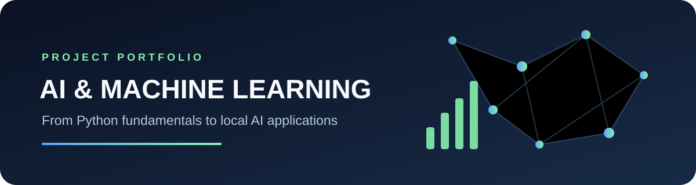
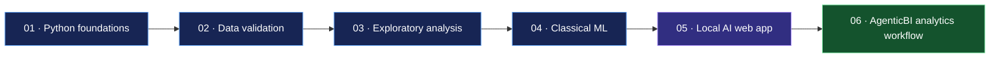

<!-- Project banner -->
<p align="center">
  
</p>

<h1 align="center">Codomax Digital Solutions · AI & Machine Learning Internship</h1>

<p align="center">
  <strong>A hands-on portfolio covering Python, data quality, analytics, classical machine learning, local AI applications, and agentic data workflows.</strong>
</p>

<p align="center">
  <a href="https://github.com/ranjiths112007/Codomax-Digital-Solutions-AI-ML-Internship-/commits/main"></a>
  
  
  
</p>

<p align="center">
  <a href="#project-roadmap">Explore projects</a> ·
  <a href="#getting-started">Getting started</a> ·
  <a href="#technology-landscape">Technology landscape</a>
</p>

---

## Overview

This repository documents practical projects built during an AI & ML internship learning path. The work progresses from Python programming and data preparation to exploratory analytics, supervised learning, a local writing-pattern analysis prototype, and a CSV-to-PowerPoint analytics application.

The goal is to keep the code, experiments, limitations, and setup instructions together so each project can be reviewed and run independently.

> **Project integrity note:** Documentation distinguishes implemented features from optional integrations and future extensions. A model is not described as trained, fine-tuned, or evaluated unless that work is actually present in the project.

## Project roadmap

| Module | Project | Main concepts | Status / entry point |
|---|---|---|---|
| 01 | **AI & Python Foundations** | AI vs. ML vs. deep learning, Python syntax, control flow, functions, collections, unit testing | [Open Task 1](Task-1/README.md) |
| 02 | **CSV Data Quality Auditor / Expense Tracker** | Data validation, missing values, duplicate detection, identifiers, input validation, file handling | [Open Task 2](Task-2/README.md) |
| 03 | **Data Analysis & Visualization** | Pandas, NumPy, exploratory data analysis (EDA), aggregation, charting with Matplotlib | [Open notebook](Task-3/Module_03_Data_Analysis_Visualization.ipynb) |
| 04 | **Machine Learning Fundamentals** | Iris classification, train/test split, Random Forest, classification metrics, confusion matrix | [Open notebook](Task-4/Module_04_Machine_Learning_Fundamentals.ipynb) |
| 05 | **HumanCheck — Writing Pattern Analyzer** | React, Vite, FastAPI, local Hugging Face inference, heuristic features, API integration | [Docs](Task-5/README.md) · [Source](Task-5/) · [Live frontend](https://ranjiths112007.github.io/Codomax-Digital-Solutions-AI-ML-Internship-/) |
| 06 | **AgenticBI — Local CSV Analyst & PPT Builder** | Pandas profiling, statistical summaries, Isolation Forest, optional local LLM narration, REST APIs, PowerPoint generation | [Docs](Task-6/AgenticBI/README.md) · [Source](Task-6/AgenticBI/) |

### How the projects build on one another



## Featured projects

### HumanCheck · Local writing-pattern analysis

HumanCheck is a full-stack prototype that analyses text using a locally available detector model when configured, alongside writing-pattern metrics and fallback analysis.

- **Frontend:** React + Vite.
- **Backend:** FastAPI.
- **Model integration:** `openai-community/roberta-base-openai-detector` is configured for local inference and can be cached on first model-backed run.
- **Deployment:** The frontend is published through GitHub Pages; a separately hosted backend is needed for deployed end-to-end analysis.
- **Important limitation:** detector output is not proof of authorship and should never be the sole basis for academic or employment decisions.

Links: [Live frontend](https://ranjiths112007.github.io/Codomax-Digital-Solutions-AI-ML-Internship-/) · [Task 5 README](Task-5/README.md)

### AgenticBI · Local CSV analyst and PowerPoint builder

AgenticBI combines deterministic data analysis with an optional local language model to create a concise, presentation-ready report from a CSV file.

- **Data engineering:** CSV parsing, schema inspection, missing-value and duplicate checks.
- **Statistical analysis:** descriptive statistics and categorical frequency summaries.
- **Anomaly detection:** Isolation Forest flags potentially unusual rows for human review.
- **LLM integration:** optional Ollama narration based on already-computed findings.
- **Reporting:** PowerPoint generation with `python-pptx` and chart generation with Matplotlib.
- **Application layer:** FastAPI endpoints and a React/Vite upload interface.
- **Safety design:** the model does not generate or execute analysis code; Python functions calculate the metrics.

Links: [Task 6 README](Task-6/AgenticBI/README.md) · [Backend](Task-6/AgenticBI/backend/) · [Frontend](Task-6/AgenticBI/frontend/)

## Technology landscape

<p>
  
  
  
  
  
  
  
  
  
</p>

The technologies above are used across different modules; not every project depends on every library.

## Getting started

### Prerequisites

- Python 3.10 or newer.
- Git.
- Node.js 18+ and npm for the React applications in Task 5 and Task 6.
- Ollama only if you want to enable AgenticBI's optional local LLM summary.

### Clone the repository

```bash
git clone https://github.com/ranjiths112007/Codomax-Digital-Solutions-AI-ML-Internship-.git
cd Codomax-Digital-Solutions-AI-ML-Internship-
```

### Run Python foundations

```bash
python Task-1/python_basics.py
python Task-1/control_flow_and_lists.py
python Task-1/beginner_programs.py
```

Run Task 1 unit tests:

```bash
python -m unittest discover -s Task-1 -p "test_*.py"
```

### Run the AgenticBI application

**Terminal 1 — backend**

```bash
cd Task-6/AgenticBI/backend
python -m venv .venv
```

Activate the virtual environment:

```powershell
# Windows PowerShell
.venv\Scripts\Activate.ps1
```

```bash
# macOS / Linux
source .venv/bin/activate
```

Install dependencies and launch the API:

```bash
pip install -r requirements.txt
uvicorn app.main:app --reload --host 127.0.0.1 --port 8000
```

**Terminal 2 — frontend**

```bash
cd Task-6/AgenticBI/frontend
npm install
npm run dev
```

Open the local URL printed by Vite. The API's interactive documentation is available at `http://127.0.0.1:8000/docs`.

**Optional local model**

```bash
ollama pull qwen2.5:7b
```

AgenticBI's statistical workflow does not require Ollama; the local model is only used to phrase a summary of calculated findings.

## Repository structure

```text
.
├── assets/
│   └── codomax-ai-banner.svg
├── .github/workflows/
│   └── deploy-humancheck.yml
├── Task-1/                         # AI concepts and Python foundations
├── Task-2/                         # Data quality / Python practice
├── Task-3/                         # EDA and visualization notebook
├── Task-4/                         # Iris classification notebook
├── Task-5/                         # HumanCheck full-stack prototype
│   ├── backend/
│   └── frontend/
└── Task-6/AgenticBI/               # Local CSV analysis and PPTX builder
    ├── backend/
    │   ├── app/
    │   ├── sample_data/
    │   └── tests/
    └── frontend/
```

## AI/ML concepts represented in this repository

- **Exploratory Data Analysis (EDA):** understanding distributions, missingness, categories, and numeric relationships before modelling.
- **Supervised classification:** learning a mapping from labelled examples to classes; Task 4 uses a Random Forest on the Iris dataset.
- **Model evaluation:** using a holdout set, accuracy, a classification report, and a confusion matrix to inspect model performance.
- **Inference:** passing new inputs to an already available model to obtain predictions or scores; inference is different from training.
- **Local LLM integration:** calling a model served on the developer's machine through Ollama; this is not the same as fine-tuning the model.
- **Anomaly detection:** using Isolation Forest to surface records that differ from the broader numeric pattern; flags need domain review.
- **REST API design:** exposing backend functionality through HTTP endpoints that a frontend can call.
- **Reproducibility:** keeping sample data, requirements, notebooks, and tests alongside implementation code.

**Not claimed unless separately implemented:** training Word2Vec embeddings, fine-tuning transformer weights, building a knowledge graph, or training a custom LLM. These are valuable future learning directions, but they are not described as completed work in this repository.

## Limitations and responsible use

- A model score is not automatically a calibrated probability or a ground-truth label.
- Synthetic sample data is useful for demos but cannot establish real-world business performance.
- Anomaly detection identifies candidates for investigation, not confirmed fraud, errors, or root causes.
- Optional LLM-generated prose can be incomplete or incorrect; computed metrics should remain the source of truth.
- Verify setup commands and model availability on the target machine before presenting a live demo.

## Roadmap

- [ ] Add screenshots from real local runs of HumanCheck and AgenticBI.
- [ ] Run and record automated tests for each Python backend.
- [ ] Add input validation and error-handling tests for CSV edge cases.
- [ ] Record a short demo showing CSV upload, findings, and PPTX export.
- [ ] Document additional internship tasks once their actual briefs and implementations are available.

## Author

**Ranjith Sivashanmugam** · AI & ML project portfolio

- GitHub: [@ranjiths112007](https://github.com/ranjiths112007)
- LinkedIn: [Connect on LinkedIn](https://www.linkedin.com/in/ranjith-sivashanmugam/)

---

<p align="center">
  <sub>Built as a learning portfolio. Implementation status and limitations are documented alongside the code.</sub>
</p>
