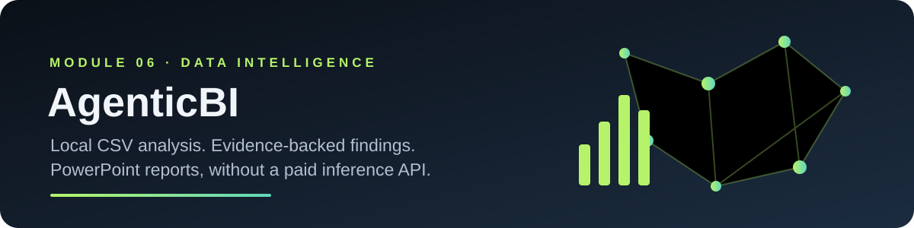
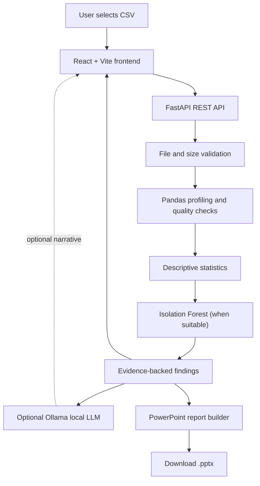

<!-- Project banner -->
<p align="center">
  
</p>

<h1 align="center">AgenticBI</h1>
<p align="center"><strong>Local CSV Analytics · Evidence-Based Findings · PowerPoint Automation</strong></p>

<p align="center">
  
  
  
  
</p>

## 1. Project overview

AgenticBI is a local-first analytics application that accepts a CSV dataset, computes data-quality and descriptive-statistics results, highlights candidate anomalies, and exports a styled PowerPoint report. An optional locally hosted language model can turn the calculated findings into a concise narrative.

The key design principle is **deterministic computation first, language-model narration second**. The LLM does not write or execute Python code, and computed statistics remain the source of truth.

> **Implementation note:** the repository currently implements a staged analytics pipeline rather than multiple independent AI agents. The stages are separated for clarity and future extension; this README does not claim that CrewAI, LangGraph, or multiple autonomous agents have been integrated.

## 2. Problem statement

CSV files often require repetitive preparation before they are useful: checking missing values, finding duplicate records, understanding column types, summarizing numeric fields, identifying unusual observations, and communicating the results to other people.

AgenticBI packages these repeatable steps into one local workflow and creates a presentation that can be reviewed and edited before it is shared.

## 3. Core capabilities

| Capability | Implementation | Why it matters |
|---|---|---|
| CSV ingestion | Pandas CSV parsing with row, column, and file-size limits | Provides a controlled input boundary |
| Schema profiling | Column names, inferred data types, row/column counts, preview | Establishes the shape of the dataset |
| Data-quality checks | Missing-cell counts, whitespace trimming, duplicate-row detection | Surfaces common quality issues |
| Descriptive analytics | Count, mean, median, minimum, maximum, sum | Produces auditable summary statistics |
| Categorical profiling | Top category counts for non-numeric columns | Shows frequent values for initial exploration |
| Unsupervised anomaly detection | Scikit-learn Isolation Forest on suitable numeric columns | Flags unusual records for human review |
| Optional LLM narrative | Ollama `/api/generate` call using computed findings as evidence | Summarizes results without outsourcing the calculations |
| Presentation generation | python-pptx and Matplotlib | Produces an editable report deck |
| HTTP API | FastAPI upload and report endpoints | Separates the UI from the analysis logic |
| Web interface | React + Vite | Makes the workflow accessible through a browser |

## 4. Architecture



### Design choices

1. **Keep calculations deterministic.** Pandas and fixed Python functions compute all reported metrics.
2. **Use the LLM as a summarizer, not an authority.** The prompt instructs the model to use only the computed evidence; the output can still be wrong and must be reviewed.
3. **Avoid dynamic code execution.** No LLM-generated Python is executed against the dataset.
4. **Make the local model optional.** The API returns computed findings even when Ollama is not running.
5. **Keep the report editable.** PowerPoint output can be reviewed and adapted by the user.

## 5. Technology stack

- **Python 3.10+** — application and analysis logic.
- **Pandas / NumPy** — tabular data manipulation and numerical operations.
- **Scikit-learn** — Isolation Forest anomaly detection.
- **FastAPI** — REST endpoints and request validation.
- **Ollama + Qwen 2.5 7B (optional)** — local narrative generation, if the model is installed and available.
- **Matplotlib** — chart rendering.
- **python-pptx** — PowerPoint document generation.
- **React + Vite** — browser interface.
- **Pytest** — backend unit tests.

No paid model-inference API key is required. Ollama is an optional local dependency, and the first model download requires an internet connection.

## 6. Data processing pipeline

1. **Ingest:** accept a CSV upload, reject unsupported file types, enforce the 15 MB upload limit.
2. **Validate:** parse the CSV and enforce row and column limits.
3. **Profile:** identify the dataset shape, column types, missing values, exact duplicate rows, and a small preview.
4. **Summarize:** compute descriptive statistics for numeric columns and frequent categories for selected non-numeric columns.
5. **Detect:** if there are enough rows and at least two useful numeric features, apply Isolation Forest and return a small list of candidate unusual rows.
6. **Explain:** optionally ask a locally served LLM to summarize the computed findings.
7. **Report:** generate a PowerPoint containing the overview, quality checks, key findings, numeric chart when available, and methodological limitations.
8. **Review:** the user validates the output against business context before making decisions.

## 7. Quick start

### Prerequisites

- Python 3.10 or newer.
- Node.js 18+ and npm.
- Optional: [Ollama](https://ollama.com/) for local LLM narration.

### Backend setup

From the repository root:

```bash
cd Task-6/AgenticBI/backend
python -m venv .venv
```

Activate the environment:

```powershell
# Windows PowerShell
.venv\Scripts\Activate.ps1
```

```bash
# macOS / Linux
source .venv/bin/activate
```

Install dependencies and start FastAPI:

```bash
pip install -r requirements.txt
uvicorn app.main:app --reload --host 127.0.0.1 --port 8000
```

Check the API at `http://127.0.0.1:8000/docs`.

### Frontend setup

In a second terminal:

```bash
cd Task-6/AgenticBI/frontend
npm install
npm run dev
```

Open the local address printed by Vite. The development server proxies `/api` requests to the local FastAPI backend.

### Optional: enable local LLM narration

Install and start Ollama, then pull the model:

```bash
ollama pull qwen2.5:7b
```

The application defaults to `qwen2.5:7b`. To select a different Ollama model, set `OLLAMA_MODEL` in the backend environment before starting the API. Without a reachable Ollama service, the deterministic findings remain available.

### Try the sample dataset

Upload `backend/sample_data/sales_sample.csv` through the web interface. It is synthetic sample data intended for functional testing, not evidence of real business performance.

## 8. API reference

| Method | Endpoint | Description |
|---|---|---|
| `GET` | `/api/health` | Health check and service metadata |
| `POST` | `/api/analyze` | Accepts a CSV upload and returns profile metrics, findings, and optional narrative as JSON |
| `POST` | `/api/report` | Accepts a CSV upload and returns a downloadable PowerPoint file |

For interactive request examples, start the backend and open `http://127.0.0.1:8000/docs`.

## 9. Testing

From the backend directory with dependencies installed:

```bash
pytest -q
```

The included tests cover core data-shape, missing-value, duplicate-row, numeric-summary, and empty-input behavior. Additional integration tests should be added for malformed files, oversized inputs, Ollama timeouts, and PowerPoint generation.

## 10. Repository layout

```text
AgenticBI/
├── README.md
├── assets/
│   └── agenticbi-banner.svg
├── backend/
│   ├── app/
│   │   ├── main.py          # FastAPI endpoints and upload handling
│   │   ├── analysis.py      # Data profiling, statistics, anomaly detection
│   │   ├── local_llm.py     # Optional Ollama narration
│   │   └── report.py        # PowerPoint report builder
│   ├── sample_data/
│   │   └── sales_sample.csv
│   ├── tests/
│   │   └── test_analysis.py
│   └── requirements.txt
└── frontend/
    ├── index.html
    ├── package.json
    ├── vite.config.js
    └── src/
        ├── main.jsx
        ├── App.jsx
        └── style.css
```

## 11. Responsible use and limitations

- **Anomaly is not a verdict.** Isolation Forest flags are candidates for investigation, not proof of fraud, errors, or misconduct.
- **No causal inference.** Descriptive statistics and unusual values do not establish why an outcome occurred.
- **LLM output is fallible.** The generated narrative can omit context or phrase a result incorrectly. Verify it against the computed metrics.
- **Data typing is imperfect.** CSV type inference may misinterpret dates, identifiers, currency strings, and mixed-type columns.
- **Not a production security review.** This starter is intended for local learning and demonstrations; review authentication, deployment configuration, logging, privacy, and access controls before exposing it to users.
- **Local processing claim:** the app reads the upload into memory and does not intentionally persist the CSV to disk. If you deploy it, review your hosting platform's request logs and infrastructure policies separately.

## 12. Future enhancements

These are **planned extensions**, not claims about the current implementation:

- Add LangGraph or CrewAI orchestration with explicit agent state, tool boundaries, and retry handling.
- Add schema-aware data cleaning suggestions with a human approval step.
- Add configurable group-by analysis, correlations, and time-series summaries.
- Add report templates, user-selected chart types, and an executive summary slide.
- Add integration tests, type checking, frontend tests, and CI quality gates.
- Add sample screenshots after capturing them from a successful local run.

## 13. Learning outcomes

This project brings together practical concepts in tabular data processing, exploratory analytics, unsupervised anomaly detection, REST API development, local LLM integration, frontend/backend communication, and automated document generation.

It does **not** currently train a custom model, fine-tune a transformer, train Word2Vec embeddings, or implement a multi-agent framework. Those would be separate additions requiring code, experiments, and evaluation evidence.

---

<p align="center"><sub>AgenticBI · Module 06 learning project · Validate every result before using it for a business decision.</sub></p>
